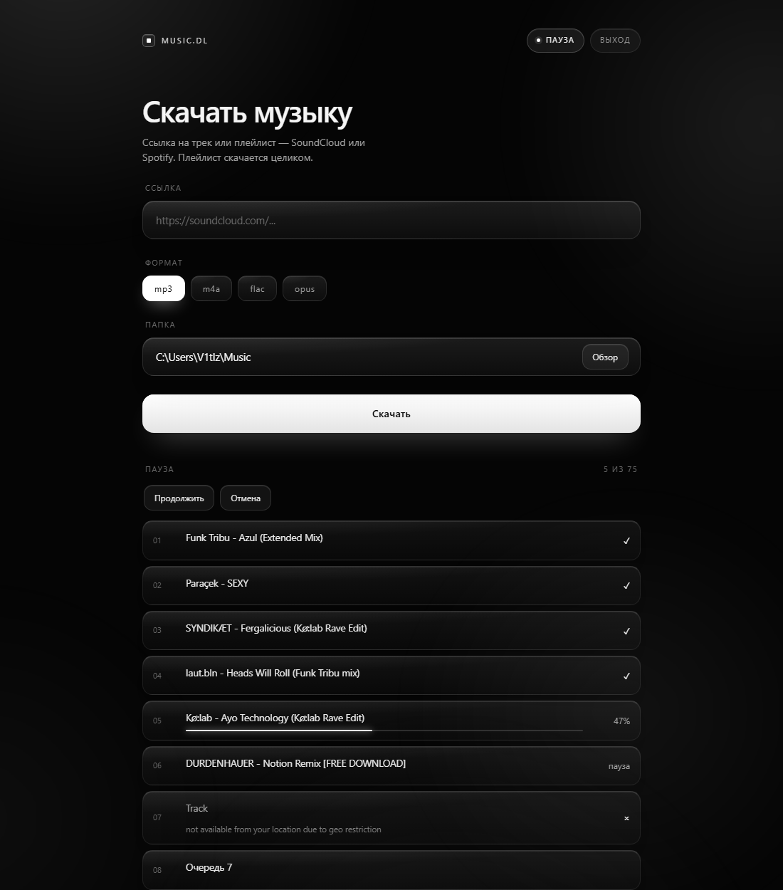

<div align="center">

# music.dl

**Трек или плейлист со SoundCloud и Spotify — в выбранную папку.**




</div>

---

## Возможности

| Возможность | Детали |
|:--|:--|
| **SoundCloud** | отдельный трек или плейлист целиком: аудио, теги, нормальные имена файлов |
| **Spotify** | название и исполнитель берутся из Spotify, звук ищется на YouTube по длительности и каналу |
| **Форматы** | `mp3` · `m4a` · `flac` · `opus` |
| **Скорость** | 5 загрузок одновременно: плейлист на 75 треков — примерно 3–4 минуты |
| **Пауза и отмена** | пауза не рвёт текущие файлы, отмена останавливает всё сразу |
| **Отчёт** | в конце список того, что не скачалось, с причиной по каждому треку |
| **Интерфейс** | локальный, в браузере, стеклянные плитки, без Electron |
| **Ноль настроек** | сам ставит Python, `yt-dlp` и `ffmpeg` при первом запуске |

## Быстрый старт

1. Скачай репозиторий: **Code → Download ZIP** и распакуй.
2. Двойной клик по **`start.bat`** — откроется интерфейс в браузере.
3. Вставь ссылку, выбери формат и папку, нажми **«Скачать»**.

> Первый запуск занимает 1–3 минуты: `start.bat` поставит Python 3.12 (если его нет),
> скрипт — `yt-dlp` и `ffmpeg` в `%LOCALAPPDATA%\music_dl`. Права администратора не нужны,
> системный Python не трогается.

## Из консоли

```bat
start.bat "https://soundcloud.com/user/track" -o "D:\Music" -f flac
start.bat "https://open.spotify.com/playlist/..." -o "D:\Music" -y
```

| Ключ | Что делает |
|:--|:--|
| `-o`, `--output` | папка для сохранения (по умолчанию `%USERPROFILE%\Music`) |
| `-f`, `--format` | `mp3` (по умолчанию), `m4a`, `flac`, `opus` |
| `-y`, `--yes` | без подтверждения |
| `--gui` | открыть интерфейс в браузере |
| `--port` | порт для `--gui` (по умолчанию свободный) |
| `--cookies` | `cookies.txt`, если YouTube просит вход |
| `--update` | обновить `yt-dlp` |
| `-V`, `--version` | версия |

## Как это работает

**SoundCloud** — качается напрямую через `yt-dlp`. Названия берутся из API SoundCloud пакетом,
поэтому в списке сразу видно «Artist — Track», а не числа.

**Spotify** — файлов не отдаёт (DRM). Из Spotify берутся название, исполнитель и длительность,
звук ищется на YouTube и выбирается по длительности, похожести названия и каналу; если видео
недоступно — пробуется следующий вариант.

## Если что-то не скачалось

<details>
<summary><b>SoundCloud: «geo restriction» / трек недоступен</b></summary>

Трек заблокирован для твоей страны или удалён. Скрипт не ломается: остальные треки качаются,
а в конце показывается список с причиной. Для гео-блокировки нужен VPN — из кода это не обойти.

</details>

<details>
<summary><b>YouTube: «Sign in to confirm you're not a bot»</b></summary>

Экспортируй cookies браузера в `cookies.txt` и запусти с `--cookies cookies.txt`.
Подойдёт расширение вроде «Get cookies.txt LOCALLY».

</details>

<details>
<summary><b>Ничего не скачалось, код 1</b></summary>

Это код возврата `yt-dlp`: не удалось скачать ни одного трека. Причина всегда печатается
строками выше — чаще всего гео-блокировка или удалённые треки.

</details>

## Требования

Windows 10/11 и интернет. Всё остальное — Python, `yt-dlp`, `ffmpeg` — ставится автоматически
при первом запуске.

<div align="center">
<sub>yt-dlp · ffmpeg · Python — без Electron, аккаунтов и телеметрии</sub>
</div>
